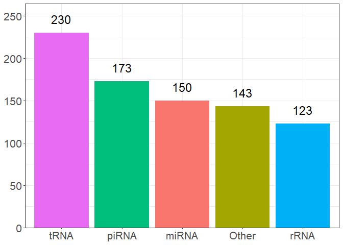
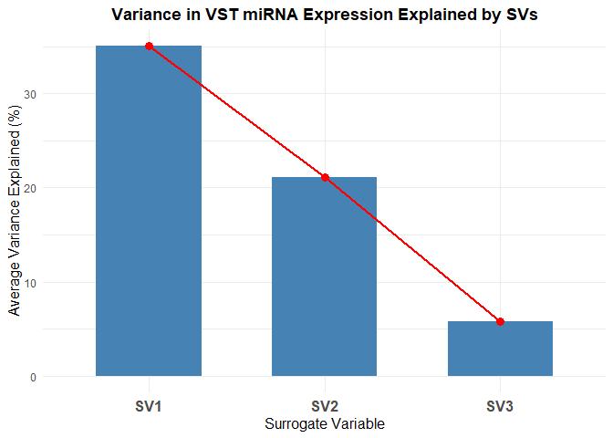
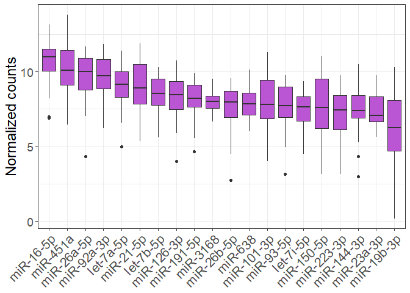
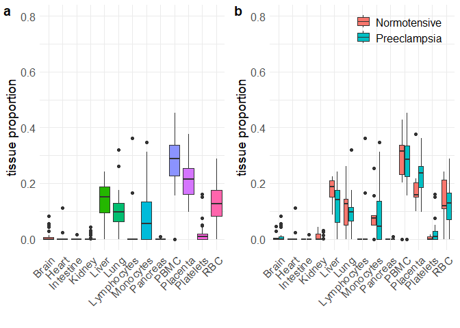
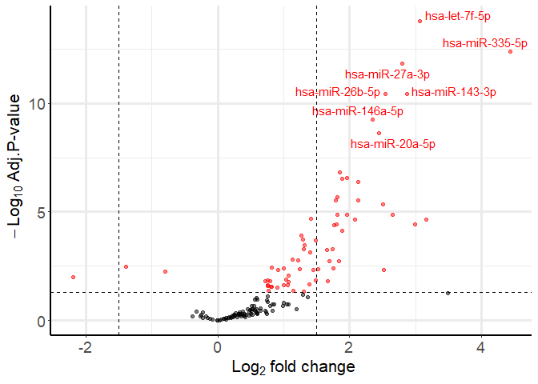
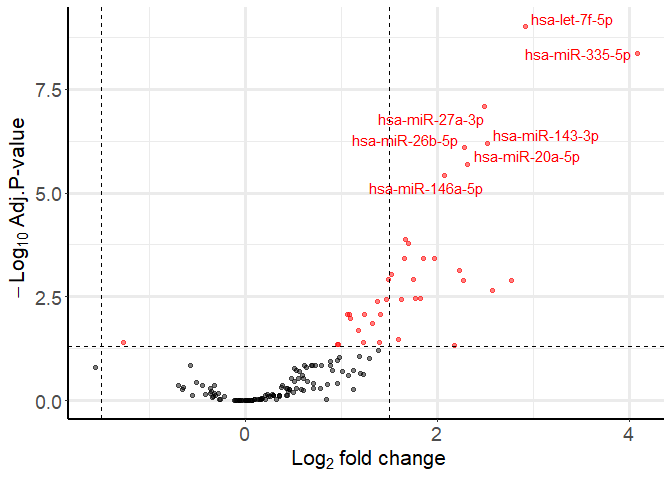
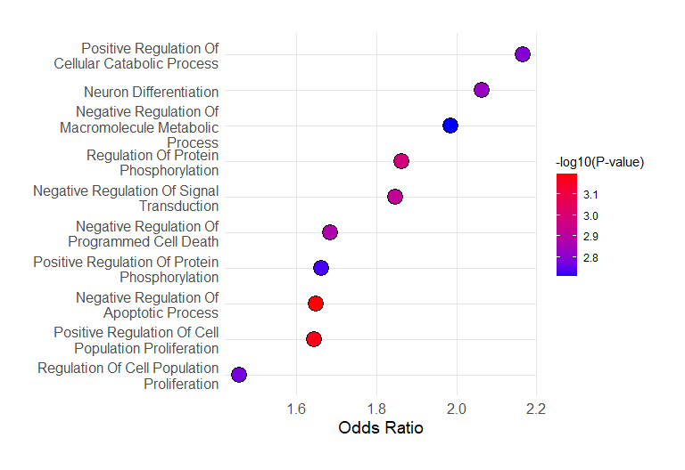
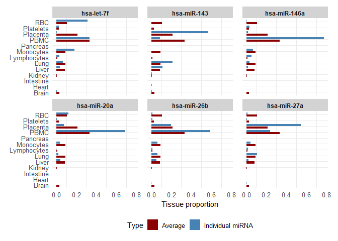

## R Markdown

This is an R Markdown documenting the processing of sncRNAseq data from
extracellular vesicles (EVs) isolated from Motherhealth plasma samples
collected postpartum. The study profiled preelampsia cases (n=26) and
normotensive controls (n=13). EVs were isolated using IZON SEC columns.
RNA was extracted using the miRNeasy isolation kit. Out of 39 samples
sent to RealSeq for small RNAseq, 35 were successfully sequenced. FASTQ
files were received with adapters trimmed. The reads were aligned using
STAR version 2.7.10b using the gencode v43 human reference genome
(hg38). Counts were generated using the featureCounts function of
Rsubread 2.12.3. Features were annotated for sRNAs using the ITAS
database following the workflow outlined by Stupnikov et al., 2022:
<https://github.com/EpiEpiMSU/ITAS>. Using this workflow, 18948 sRNA
elements were detected. Low abundant reads were filtered with a cutoff
of mean count \> 5, with 819 elements remaining
(<https://www.mdpi.com/1422-0067/24/4/4195>). The most abundant snRNA
features were miRNA (n=150), Other (n=143), piRNA (n=173), rRNA (n=123),
and tRNA (n=230). Further analyses were restricted to the miRNA dataset.

CIBERSORT was conducted to ennumerate EV cell-type contributions using a
published miRNA tissue reference dataset(Srinivasan et al., 2020;
<PMID:32864636>). Differential expression analysis adjusting for 2
surrogate variables and maternal BMI at delivery revealed 67 miRNAs
associated with preeclampsia status at an FDR \< 0.05. In a sensitivity
analysis, gestational age was included as an additional covariate. Based
on this model, 38 miRNAs remained significantly associated with
preeclampsia status. Gene Ontology Enrichment Pathway analysis was
performed on gene targets of all differentially expressed miRNAs.
Finally, fractional tissue contributions were estimated for all
differentially expressed EV miRNAs.

## Load Covariate data

``` r
Covariates<-readRDS(paste0(base.dir,"Data/Covariates/Covariates_pilot.rds"))

CIBERSORT_reference<-readRDS("C:/Users/mk2583/OneDrive - Columbia University Irving Medical Center/Deyssenroth_Lab/Tutorials/miRNATissueAtlas_CIBERSORT/miRNA_reference.rds")

#ensembl = useMart("ENSEMBL_MART_ENSEMBL",dataset="hsapiens_gene_ensembl")
#if ensembl server is down, load local dataset (release 116)
ensembl<-readRDS(paste0(base.dir,"Studies/EV/sncRNAseq/scripts/R_code/ensembl.rds"))
```

## Clean-up covariate data

``` r
Covariates<-Covariates%>%
  droplevels()
```

## Table 1 comparing cases and controls

``` r
demo<-Covariates%>%
  mutate(delivery_mode=ifelse(delivery_mode=="C/S","C-Section","Vaginal"))%>%
  dplyr::select(Group,Collection_interval,BMI,Primiparous,IVF,delivery_mode,Gest.age,FGR,Race.ethnicity,Edu,Insurance)%>%
tbl_summary(
    by = Group,
    statistic = list(all_continuous()  ~ "{mean} ({sd})",
                     all_categorical() ~ "{n}    ({p}%)"),
    digits = list(all_continuous()  ~ c(2, 2),
                  all_categorical() ~ c(0, 1)),
    type = list(Collection_interval ~ "continuous",
                BMI ~ "continuous",
                Primiparous ~ "categorical",
                IVF ~ "categorical",
                Race.ethnicity ~ "categorical",
                delivery_mode ~ "categorical",
                Gest.age ~ "continuous",
                FGR ~ "categorical"),
    label  = list(Collection_interval ~ "Time to collection (days)",
                BMI ~ "BMI at Delivery",
                Race.ethnicity ~ "Race/ethnicity",
                delivery_mode ~ "Delivery Mode",
                Gest.age ~ "Gestational age (weeks)")
  ) %>%
  add_p(pvalue_fun = ~ style_pvalue(.x, digits = 2)) %>%
  modify_header(label = "**Variable**",
                all_stat_cols() ~ "**{level}**<br>N = {n} ({style_percent(p, digits=1)}%)") %>%
  bold_labels() %>%
  modify_caption("<div style='text-align: left; font-weight: bold;'>Table1. Motherhealth participant characteristics</div>")


Demo_table_study_csv<-demo%>%
 as_tibble() 

#knitr::knit_print(demo)
demo%>%
  as_kable()
```

Table:

<div style="text-align: left; font-weight: bold;">

Table1. Motherhealth participant characteristics

</div>

| **Variable** | **Normotensive**<br>N = 9 (25.7%) | **Preeclampsia**<br>N = 26 (74.3%) | **p-value** |
|:---|:--:|:--:|:--:|
| **Time to collection (days)** | 1.33 (0.71) | 2.15 (1.32) | 0.10 |
| **BMI at Delivery** | 27.29 (2.92) | 32.27 (5.12) | 0.008 |
| **Primiparous** |  |  | 0.67 |
| No | 5 (71.4%) | 11 (57.9%) |  |
| Yes | 2 (28.6%) | 8 (42.1%) |  |
| Unknown | 2 | 7 |  |
| **IVF** |  |  | 0.65 |
| No | 8 (88.9%) | 19 (73.1%) |  |
| Yes | 1 (11.1%) | 7 (26.9%) |  |
| **Delivery Mode** |  |  | 0.26 |
| C-Section | 3 (33.3%) | 15 (57.7%) |  |
| Vaginal | 6 (66.7%) | 11 (42.3%) |  |
| **Gestational age (weeks)** | 39.24 (0.93) | 35.00 (2.84) | \<0.001 |
| **FGR** |  |  | 0.55 |
| No | 7 (100.0%) | 15 (78.9%) |  |
| Yes | 0 (0.0%) | 4 (21.1%) |  |
| Unknown | 2 | 7 |  |
| **Race/ethnicity** |  |  | 0.58 |
| Non-Hispanic White | 3 (37.5%) | 6 (24.0%) |  |
| Hispanic | 4 (50.0%) | 17 (68.0%) |  |
| Black | 1 (12.5%) | 2 (8.0%) |  |
| Unknown | 1 | 1 |  |
| **Edu** |  |  | \>0.99 |
| College | 3 (60.0%) | 10 (58.8%) |  |
| High School | 1 (20.0%) | 2 (11.8%) |  |
| Some college | 1 (20.0%) | 5 (29.4%) |  |
| Unknown | 4 | 9 |  |
| **Insurance** |  |  | 0.63 |
| Private | 6 (85.7%) | 13 (68.4%) |  |
| Public | 1 (14.3%) | 6 (31.6%) |  |
| Unknown | 2 | 7 |  |

``` r
#save table  
write.csv(Demo_table_study_csv, paste0(output.dir,"Tables/Table1_demographics.csv"))
```

## Table 2 presenting case characteristics

``` r
PE_characteristics<-Covariates%>%
  filter(Group=="Preeclampsia")%>%
  dplyr::select(organ_dysfunction,Proteinuria,Antihyp_rx)%>%
  tbl_summary(
    statistic = list(all_continuous()  ~ "{mean} ({sd})",
                     all_categorical() ~ "{n}    ({p}%)"),
    digits = list(all_continuous()  ~ c(2, 2),
                  all_categorical() ~ c(0, 1)),
    type = list(organ_dysfunction ~ "categorical",
                Proteinuria ~ "categorical",
                Antihyp_rx ~ "categorical"),
    label  = list(organ_dysfunction ~ "Organ dysfunction",
                Antihyp_rx ~ "Anti-hypertensive Rx")
  ) %>%
  modify_header(label = "**Variable**",
                all_stat_cols() ~ "**{level}**<br>N = {n} ({style_percent(p, digits=1)}%)") %>%
  bold_labels() %>%
  modify_caption("<div style='text-align: left; font-weight: bold;'>Table2. Preeclampsia case characteristics</div>")

PE_characteristics_csv<-demo%>%
 as_tibble() 

#knitr::knit_print(demo)
PE_characteristics%>%
  as_kable()
```

Table:

<div style="text-align: left; font-weight: bold;">

Table2. Preeclampsia case characteristics

</div>

| **Variable**             | **Overall**<br>N = 26 (100.0%) |
|:-------------------------|:------------------------------:|
| **Organ dysfunction**    |                                |
| No                       |           8 (30.8%)            |
| Yes                      |           18 (69.2%)           |
| **Proteinuria**          |                                |
| No                       |           8 (30.8%)            |
| Yes                      |           18 (69.2%)           |
| **Anti-hypertensive Rx** |                                |
| No                       |           7 (26.9%)            |
| Yes                      |           19 (73.1%)           |

``` r
#save table  
write.csv(PE_characteristics_csv, paste0(output.dir,"Tables/Table2_PE_characteristics.csv"))
```

# Find file locations of bam files

``` r
# Function to recursively search for files with specific extensions
find_files <- function(directory, extensions) {
  files <- dir_ls(directory, recurse = TRUE)
  filtered_files <- files[str_detect(files, paste0("\\.", extensions, "$"))]
  as.character(filtered_files)
}

# path to directory
directory <- paste0(base.dir,"Data/RNAseq/STAR/STAR_align_clean")

# Replace with the directory you want to search in
extensions <- c("bam")     # Replace with the desired extensions

file_locations <- find_files(directory, extensions)
#print(file_locations)
file.exists(file_locations)
```

    ##  [1] TRUE TRUE TRUE TRUE TRUE TRUE TRUE TRUE TRUE TRUE TRUE TRUE TRUE TRUE TRUE
    ## [16] TRUE TRUE TRUE TRUE TRUE TRUE TRUE TRUE TRUE TRUE TRUE TRUE TRUE TRUE TRUE
    ## [31] TRUE TRUE TRUE TRUE TRUE

``` r
#35 files found
```

## Count features and annotate snRNAs

``` r
# count and annotate snrna features 
gtffile <- file.path(paste0(base.dir,"Data/RNAseq/ITAS/Integrated_annotation/human/human_allRNA/human_allRNA.gtf"))

invisible(capture.output(
fc<-featureCounts(files=file_locations, 
                  annot.ext=gtffile, 
                  isGTFAnnotationFile = TRUE, 
                  GTF.featureType = "exon", 
                  GTF.attrType = "transcript_id", 
                  minFragLength=15,
                  isPairedEnd=FALSE),
file=paste0(base.dir,"Studies/EV/sncRNAseq/QC/featurecounts.log")
))
```

## Create DESeq2 dataset

``` r
dds<-DESeqDataSetFromMatrix(countData=fc$counts,
                            colData=Covariates,
                            design= ~ BMI + Group)

dds
```

    ## class: DESeqDataSet 
    ## dim: 18948 35 
    ## metadata(1): version
    ## assays(1): counts
    ## rownames(18948): 5S_1675 5S_1676 ... tRX-Val-NNN-4-1 tRX-Val-NNN-5-1
    ## rowData names(0):
    ## colnames(35): RSB477-01Aligned.sortedByCoord.out.bam
    ##   RSB477-02Aligned.sortedByCoord.out.bam ...
    ##   RSB478-23Aligned.sortedByCoord.out.bam
    ##   RSB478-24Aligned.sortedByCoord.out.bam
    ## colData names(20): SID Group ... seqid bam

``` r
all(colnames(dds)==dds$bam) #TRUE
```

    ## [1] TRUE

## Pre-filtering

``` r
keep<-rowMeans(counts(dds)) >5
summary(keep) #819
```

    ##    Mode   FALSE    TRUE 
    ## logical   18129     819

``` r
dds<-dds[keep,]
```

## RNA species

``` r
#label RNA species
txdb_dds<-counts(dds)
  
txdb_dds<-txdb_dds%>%
  as.data.frame()%>%
  rownames_to_column("Gene")%>%
  mutate(TXTYPE=factor(ifelse(grepl("hsa-let|hsa-miR",Gene),"miRNA",
                            ifelse(grepl("piR",Gene),"piRNA",
                                   ifelse(grepl("rRNA",Gene),"rRNA",
                                      ifelse(grepl("tRNA",Gene),"tRNA","Other"))))))%>%
  dplyr::select(Gene,TXTYPE)

summary(factor(txdb_dds$TXTYPE))
```

    ## miRNA Other piRNA  rRNA  tRNA 
    ##   150   143   173   123   230

``` r
#miRNA Other piRNA  rRNA  tRNA 
#  150   143   173   123   230


RNA_profile<-ggplot(txdb_dds, aes(reorder(TXTYPE,TXTYPE,function(x)-length(x)),fill=TXTYPE))+
  geom_bar()+
  theme_bw()+
  geom_text(stat = "count", aes(label = after_stat(count)),vjust=-1,size=6)+
  scale_y_continuous(expand=expansion(mult=c(0,0.15)))+
  theme(axis.title=element_blank(),
    axis.text=element_text(size=16),
    legend.position = "none")

RNA_profile
```

<!-- -->

``` r
ggsave(paste0(output.dir,"Plots/sRNAbiotypes.tiff"), plot = RNA_profile, device = "tiff",dpi = 300,width=6,height=4,units="in")

#pull out miRNA identifiers
miRNA<-txdb_dds$Gene[txdb_dds$TXTYPE=="miRNA"]
```

## Normalize

``` r
dds<-DESeq(dds)
```

## Conduct surrogate variable analysis

``` r
dat  <- getVarianceStabilizedData(dds)
idx  <- rowMeans(dat) > 1 #all
dat  <- dat[idx, ]
mod <- model.matrix(~ BMI + Group,colData(dds))
mod0 <- model.matrix(~   1, colData(dds))

n.sv <- num.sv(dat,mod,method="be") #3
svseq <- svaseq(dat, mod, mod0, n.sv = 3)
```

    ## Number of significant surrogate variables is:  3 
    ## Iteration (out of 5 ):1  2  3  4  5

``` r
ddssva <- dds
ddssva$SV1 <- svseq$sv[,1]
ddssva$SV2 <- svseq$sv[,2]
ddssva$SV3 <- svseq$sv[,3]

## save vst-normalized data
#saveRDS(dat,"output/normalized_data/vst.RDS")
```

## assess variance explained by SVs and collinearity with known variables

``` r
vst_matrix_mirna <- dat[rownames(dat) %in% miRNA, ]

sv_matrix<-svseq$sv
num_svs<-ncol(sv_matrix)

variance_explained <- numeric(num_svs)

sv_variances <- apply(sv_matrix, 2,var)
percent_variance <- (sv_variances / sum(sv_variances)) * 100
scree_data<- data.frame(
  SV = factor(paste0("SV", 1:ncol(sv_matrix)), levels = paste0("SV", 1:ncol(sv_matrix))),
  Variance = percent_variance
)

for (i in 1:num_svs) {
  sv_vector <- sv_matrix[, i]
  
  # Calculate R-squared for each miRNA against the SV
  # t(vst_matrix) flips it so miRNAs are columns
  r_squared <- cor(t(vst_matrix_mirna), sv_vector, use = "pairwise.complete.obs")^2
  
  # Average the R-squared across all miRNAs
  variance_explained[i] <- mean(r_squared, na.rm = TRUE) * 100
}

scree_data <- data.frame(
  SV = factor(paste0("SV", 1:num_svs), levels = paste0("SV", 1:num_svs)),
  Variance = variance_explained
)

ggplot(scree_data, aes(x = SV, y = Variance)) +
  geom_bar(stat = "identity", fill = "steelblue", width = 0.6) +
  geom_line(aes(group = 1), color = "red", linewidth = 1) +
  geom_point(color = "red", size = 3) +
  theme_minimal() +
  labs(
    title = "Variance in VST miRNA Expression Explained by SVs",
    x = "Surrogate Variable",
    y = "Average Variance Explained (%)"
  ) +
  theme(
    plot.title = element_text(hjust = 0.5, face = "bold"),
    axis.text.x = element_text(size = 12, face = "bold"),
    axis.title = element_text(size = 12)
  )
```

<!-- -->

``` r
## collinearity with BMI and gestational age
sv_df <- as.data.frame(svseq$sv)
colnames(sv_df) <- paste0("SV", 1:ncol(sv_df))
sv_df$BMI <- colData(dds)$BMI
sv_df$Gestational_Age <- colData(dds)$Gest.age


SV_corr<-sv_df%>%
  pivot_longer(cols=c(BMI,Gestational_Age),names_to="Demo",values_to="Demo_value")%>%
  pivot_longer(cols=starts_with("SV"),names_to="SV",values_to="SV_value")%>%
  group_by(Demo,SV)%>%
  nest()%>%
  mutate(test=map(data,~cor.test(.x$Demo_value,.x$SV_value,method="spearman",exact=FALSE)),
         tidied=map(test,tidy))%>%
  unnest(tidied)%>%
  dplyr::select(Demo,SV,estimate,p.value)

print(SV_corr)
```

    ## # A tibble: 6 × 4
    ## # Groups:   Demo, SV [6]
    ##   Demo            SV    estimate p.value
    ##   <chr>           <chr>    <dbl>   <dbl>
    ## 1 BMI             SV1     0.0363  0.836 
    ## 2 BMI             SV2     0.0783  0.655 
    ## 3 BMI             SV3     0.0538  0.759 
    ## 4 Gestational_Age SV1    -0.0840  0.632 
    ## 5 Gestational_Age SV2    -0.288   0.0930
    ## 6 Gestational_Age SV3    -0.297   0.0834

## subset dataset to miRNA only

``` r
ddssva_miRNA<-ddssva[row.names(counts(ddssva))%in%miRNA,]
```

## Top most expressed miRNAs

``` r
vsd <- varianceStabilizingTransformation(ddssva_miRNA, blind = TRUE)
select<-order(rowMeans(counts(ddssva_miRNA,normalized=TRUE)),
                decreasing=TRUE)[1:20]

top.genes<-assay(vsd)[select,]

top.gene.plot<-top.genes%>%
  as_tibble(.,rownames=NA)%>%
  rownames_to_column(var="miRNA")%>%
  mutate(miRNA=str_replace(miRNA,"^[^Hsa]*Hsa_",""),
         miRNA=str_replace(miRNA,"^[^hsa]*hsa-",""))%>%
  pivot_longer(-c("miRNA"),names_to="ID", values_to="counts")%>%
  group_by(miRNA)%>%
  ggplot(.,aes(x=fct_reorder(miRNA, counts, .fun = median, .desc =TRUE),y=counts))+
  geom_boxplot(fill="mediumorchid")+
  theme_bw()+
  theme(axis.title.x=element_blank(),
        axis.title.y=element_text(size=18),
        axis.text.x=element_text(angle=45,vjust=1,hjust=1,size=16),
        axis.text.y=element_text(size=14),
        legend.title=element_blank())+
  labs(y="Normalized counts")

top.gene.plot
```

<!-- -->

``` r
ggsave(paste0(output.dir,"Plots/miRNA_only/Figure1_top20.expressed.loci.pdf"), plot = top.gene.plot, dpi = 300,width=10,height=4,units="in")
```

## Perform CIBERSORT on normalized data

``` r
## subset to miRNAs in reference
miRNA_data<-dat[rownames(dat)%in%CIBERSORT_reference$miRNA,] #105
miRNA_data[is.na(miRNA_data)]<-0   # replace Nas in data for 0

## format reference
CIBERSORT_reference<-CIBERSORT_reference%>%
  filter(miRNA%in%rownames(miRNA_data))%>%
  column_to_rownames(., 'miRNA')

# deconvolution
mirDecon <- cibersort(as.matrix(CIBERSORT_reference), as.matrix(miRNA_data))
colnames(mirDecon)
```

    ##  [1] "Lung"        "Intestine"   "Pancreas"    "Liver"       "Kidney"     
    ##  [6] "Heart"       "Brain"       "Placenta"    "Lymphocytes" "Monocytes"  
    ## [11] "PBMC"        "Platelets"   "RBC"         "P-value"     "Correlation"
    ## [16] "RMSE"

``` r
mirDecon<-mirDecon[, 1:13]# select tissue columns

mirDecon<-mirDecon%>%
  as_tibble(rownames = "bam")%>%
  left_join(Covariates %>% dplyr::select(bam,SID,Group,BMI,delivery_mode))

## plot tissue contributions
mirDecon_long<-mirDecon%>%
  pivot_longer(!c(SID,bam,Group,BMI,delivery_mode),names_to="Tissue",values_to="Value")

mirDecon_tissue_plot<-ggplot(mirDecon_long, aes(x = Tissue, y = Value,fill = Tissue)) +
  geom_boxplot()+
  xlab('')+
  ylab("tissue proportion")+
  ylim(0,0.8)+
  theme_minimal()+ 
  theme(axis.title=element_text(size=14),
        axis.text.y=element_text(size=12),
        axis.text.x =element_text(size=12,angle = 45, vjust = 1, hjust=1),
        legend.position = "none")

## Differences in cell type contributions by PE status
mirDecon_PE_ttest<-mirDecon_long %>%
  drop_na(Value)%>%
  nest(data = -c(Tissue)) %>% 
  mutate(
    fit = map(data, ~ t.test(Value ~ Group, data = .x)),
    tidied = map(fit, broom::tidy)) %>% 
  unnest(tidied)
#liver, platelets

mirDecon_PE_plot<-ggplot(mirDecon_long, aes(x = Tissue, y = Value,fill = Group)) +
  geom_boxplot()+
  xlab('')+
  ylab("tissue proportion")+
  ylim(0,0.8)+
  theme_minimal()+ 
  theme(axis.title=element_text(size=14),
        axis.text.y=element_text(size=12),
        axis.text.x =element_text(size=12,angle = 45, vjust = 1, hjust=1),
        legend.position=c(0.7,0.9),
        legend.text=element_text(size=12),
        legend.title=element_blank())

## combine in a single figure
figure_2<-ggarrange(mirDecon_tissue_plot, mirDecon_PE_plot,
                    labels = c("a", "b"),
                    ncol = 2, nrow = 1)

figure_2
```

<!-- -->

``` r
ggsave(paste0(output.dir,"Plots/miRNA_only/Figure2_mirDecon_combined.pdf"), plot = figure_2, dpi = 450,width=6.5,height=3.5,units="in")
```

## Conduct differential gene expression analysis with respect to preeclampsia, including BMI and top 2 SVs as covariates

``` r
design(ddssva_miRNA) <- ~ BMI + SV1 + SV2 + Group

ddssva_miRNA<-DESeq(ddssva_miRNA)

res_miRNA <- results(ddssva_miRNA,contrast=c("Group","Preeclampsia","Normotensive"))
res_miRNA<-res_miRNA[order(res_miRNA$pvalue),]
res_miRNA
```

    ## log2 fold change (MLE): Group Preeclampsia vs Normotensive 
    ## Wald test p-value: Group Preeclampsia vs Normotensive 
    ## DataFrame with 150 rows and 6 columns
    ##                  baseMean log2FoldChange     lfcSE        stat      pvalue
    ##                 <numeric>      <numeric> <numeric>   <numeric>   <numeric>
    ## hsa-let-7f-5p    156.7191        3.06601  0.369507     8.29756 1.06268e-16
    ## hsa-miR-335-5p    36.0766        4.43278  0.567315     7.81362 5.55671e-15
    ## hsa-miR-27a-3p   152.1596        2.79079  0.367259     7.59898 2.98477e-14
    ## hsa-miR-143-3p    56.6845        2.86583  0.403722     7.09853 1.26091e-12
    ## hsa-miR-26b-5p   285.1999        2.54550  0.358671     7.09704 1.27459e-12
    ## ...                   ...            ...       ...         ...         ...
    ## hsa-miR-125a-5p  44.19169     0.05665438  0.360368  0.15721265    0.875077
    ## hsa-miR-328-3p    4.90336     0.12666597  0.823942  0.15373164    0.877821
    ## hsa-miR-99a-5p   68.42227     0.02399523  0.359219  0.06679835    0.946742
    ## hsa-miR-7157-5p   7.26312    -0.01023945  0.397052 -0.02578868    0.979426
    ## hsa-miR-543      11.98875    -0.00420098  0.498587 -0.00842577    0.993277
    ##                        padj
    ##                   <numeric>
    ## hsa-let-7f-5p   1.59402e-14
    ## hsa-miR-335-5p  4.16753e-13
    ## hsa-miR-27a-3p  1.49239e-12
    ## hsa-miR-143-3p  3.82376e-11
    ## hsa-miR-26b-5p  3.82376e-11
    ## ...                     ...
    ## hsa-miR-125a-5p    0.895736
    ## hsa-miR-328-3p     0.895736
    ## hsa-miR-99a-5p     0.959536
    ## hsa-miR-7157-5p    0.985999
    ## hsa-miR-543        0.993277

``` r
summary(res_miRNA,alpha=0.05)
```

    ## 
    ## out of 150 with nonzero total read count
    ## adjusted p-value < 0.05
    ## LFC > 0 (up)       : 64, 43%
    ## LFC < 0 (down)     : 3, 2%
    ## outliers [1]       : 0, 0%
    ## low counts [2]     : 0, 0%
    ## (mean count < 5)
    ## [1] see 'cooksCutoff' argument of ?results
    ## [2] see 'independentFiltering' argument of ?results

``` r
#LFC > 0 (up)       : 64, 43%
#LFC < 0 (down)     : 3, 2%
#outliers [1]       : 0, 0%
#low counts [2]     : 0, 0%
sum(res_miRNA$padj < 0.05, na.rm=TRUE) #67
```

    ## [1] 67

``` r
res_miRNA<-as.data.frame(res_miRNA)

res_miRNA<-res_miRNA%>%
  rownames_to_column(var="gene_id")

## volcano plot
res_volcano_05<-res_miRNA%>%
  mutate(sig=factor(ifelse(padj < 0.05,"sig","not.sig")))%>%
  drop_na(padj)%>%
  ggplot(aes(x=log2FoldChange, y=-log10(padj), colour=sig,label=gene_id))+
  geom_point(alpha=0.5) +
  scale_color_manual(values=c("black", "red")) +
  geom_text_repel(aes(label=ifelse(padj<10^(-8),as.character(gene_id),"")),size=4,max.overlaps=20)+
  geom_hline(yintercept=-log10(0.05), linetype="dashed") +
  geom_vline(xintercept=c(-1.5, 1.5), linetype="dashed") +
  labs(x=bquote(~Log[2] ~ "fold change"),y=bquote(~-Log[10] ~ "Adj.P-value"))+
  theme_bw()+
  theme(panel.border = element_blank(),
        axis.line = element_line(color = 'black',size=1),
        panel.grid.major = element_line(linewidth = (1.2)),
        panel.grid.minor=element_line(),
        axis.title=element_text(size=16,face="bold"),
        axis.text=element_text(size=14),
        legend.position = "none")

res_volcano_05
```

<!-- -->

``` r
ggsave(paste0(output.dir,"Plots/miRNA_only/Figure3_volcano_preeclampsia_adjBMI.SVs_miRNAonly.pdf"), plot = res_volcano_05, dpi = 300, width=4,height=4,units = "in")

write.csv(res_miRNA,paste0(output.dir,"Tables/Supplemental/miRNA_only/SupplementalTable1_res_preeclampsia_adjBMI.SVs_miRNAonly.csv"))
```

## Sensitivity analysis: Differential gene expression analysis with respect to preeclampsia, including gestational age, BMI, and top 2 SVs as covariates

``` r
design(ddssva_miRNA) <- ~ Gest.age + BMI + SV1 + SV2 + Group

ddssva_miRNA<-DESeq(ddssva_miRNA)

res_miRNA_ga <- results(ddssva_miRNA,contrast=c("Group","Preeclampsia","Normotensive"))
res_miRNA_ga<-res_miRNA_ga[order(res_miRNA_ga$pvalue),]
res_miRNA_ga
```

    ## log2 fold change (MLE): Group Preeclampsia vs Normotensive 
    ## Wald test p-value: Group Preeclampsia vs Normotensive 
    ## DataFrame with 150 rows and 6 columns
    ##                 baseMean log2FoldChange     lfcSE        stat      pvalue
    ##                <numeric>      <numeric> <numeric>   <numeric>   <numeric>
    ## hsa-let-7f-5p   156.7191        2.91400  0.423977     6.87303 6.28509e-12
    ## hsa-miR-335-5p   36.0766        4.08531  0.623679     6.55034 5.74070e-11
    ## hsa-miR-27a-3p  152.1596        2.49226  0.413043     6.03391 1.60038e-09
    ## hsa-miR-143-3p   56.6845        2.51865  0.446663     5.63882 1.71217e-08
    ## hsa-miR-26b-5p  285.1999        2.28584  0.410784     5.56459 2.62770e-08
    ## ...                  ...            ...       ...         ...         ...
    ## hsa-miR-584-5p   6.73632     0.01661863  0.629349  0.02640606    0.978933
    ## hsa-miR-497-5p  12.44467     0.00981336  0.502594  0.01952540    0.984422
    ## hsa-miR-30d-5p 102.99608    -0.00658300  0.379776 -0.01733392    0.986170
    ## hsa-miR-543     11.98875     0.01003133  0.579831  0.01730043    0.986197
    ## hsa-miR-574-3p   5.58254     0.00312711  0.733458  0.00426351    0.996598
    ##                       padj
    ##                  <numeric>
    ## hsa-let-7f-5p  9.42763e-10
    ## hsa-miR-335-5p 4.30552e-09
    ## hsa-miR-27a-3p 8.00189e-08
    ## hsa-miR-143-3p 6.42063e-07
    ## hsa-miR-26b-5p 7.88309e-07
    ## ...                    ...
    ## hsa-miR-584-5p    0.992816
    ## hsa-miR-497-5p    0.992816
    ## hsa-miR-30d-5p    0.992816
    ## hsa-miR-543       0.992816
    ## hsa-miR-574-3p    0.996598

``` r
summary(res_miRNA_ga,alpha=0.05)
```

    ## 
    ## out of 150 with nonzero total read count
    ## adjusted p-value < 0.05
    ## LFC > 0 (up)       : 37, 25%
    ## LFC < 0 (down)     : 1, 0.67%
    ## outliers [1]       : 0, 0%
    ## low counts [2]     : 0, 0%
    ## (mean count < 5)
    ## [1] see 'cooksCutoff' argument of ?results
    ## [2] see 'independentFiltering' argument of ?results

``` r
#LFC > 0 (up)       : 64, 43%
#LFC < 0 (down)     : 3, 2%
#outliers [1]       : 0, 0%
#low counts [2]     : 0, 0%
sum(res_miRNA_ga$padj < 0.05, na.rm=TRUE) #38
```

    ## [1] 38

``` r
res_miRNA_ga<-as.data.frame(res_miRNA_ga)

res_miRNA_ga<-res_miRNA_ga%>%
  rownames_to_column(var="gene_id")

## volcano plot
res_volcano_05_ga<-res_miRNA_ga%>%
  mutate(sig=factor(ifelse(padj < 0.05,"sig","not.sig")))%>%
  drop_na(padj)%>%
  ggplot(aes(x=log2FoldChange, y=-log10(padj), colour=sig,label=gene_id))+
  geom_point(alpha=0.5) +
  scale_color_manual(values=c("black", "red")) +
  geom_text_repel(aes(label=ifelse(padj<10^(-5),as.character(gene_id),"")),size=4,max.overlaps=20)+
  geom_hline(yintercept=-log10(0.05), linetype="dashed") +
  geom_vline(xintercept=c(-1.5, 1.5), linetype="dashed") +
  labs(x=bquote(~Log[2] ~ "fold change"),y=bquote(~-Log[10] ~ "Adj.P-value"))+
  theme_bw()+
  theme(panel.border = element_blank(),
        axis.line = element_line(color = 'black',size=1),
        panel.grid.major = element_line(linewidth = (1.2)),
        panel.grid.minor=element_line(),
        axis.title=element_text(size=16,face="bold"),
        axis.text=element_text(size=14),
        legend.position = "none")

res_volcano_05_ga
```

<!-- -->

``` r
write.csv(res_miRNA_ga,paste0(output.dir,"Tables/Supplemental/miRNA_only/SupplementalTable2_res_preeclampsia_adjBMI.GA.SVs_miRNAonly.csv"))
```

## GO enrichment function

``` r
analyze_mirna_targets <- function(mirna_list, 
                                  species = "hsa", 
                                  prediction_type = "predicted", 
                                  stringency = "high") {
  
  # Get predicted miRNA targets from multiple databases
  predicted_targets <- get_multimir(
    org = species,
    mirna = mirna_list,
    table = prediction_type,
    summary = TRUE
  )
  
  target_data <- predicted_targets@data
  
  # warning if multiMiR returns nothing
  if(is.null(target_data) || nrow(target_data) == 0) {
    warning("No targets found in multiMiR for the provided miRNAs.")
    return(NULL)
  }
  
  # select predicted targets based on distinct database counts
  if (stringency != "min") {
    
    #calculate how many distinct databases predict each gene
    target_summary <- target_data %>%
      group_by(target_symbol) %>%
      summarise(db_count = n_distinct(database), .groups = 'drop')
    
    threshold <- ifelse(stringency == "high", 3, 2)
    valid_targets <- target_summary$target_symbol[target_summary$db_count >= threshold]
    
  } else {
    valid_targets <- unique(target_data$target_symbol)
  }
  
  # clean targets (remove NAs and empty strings before sending to API)
  target_genes <- valid_targets[!is.na(valid_targets) & valid_targets != ""]
  
  # Check if we have a viable number of genes for enrichment
  if(length(target_genes) > 5000) {
    warning(paste("Target list is very large (", length(target_genes), 
                  "genes). GO enrichment may yield no significant hits due to background similarity. Consider increasing stringency."))
  }
  
  # perform GO enrichment analysis (Updated Database!)
  go_db <- "GO_Biological_Process_2023"
  go_bp <- enrichr(target_genes, go_db)
  
  # create results list
  results <- list(
    GO_biological_process = go_bp[[go_db]],
    targets = predicted_targets@summary
  )
  
  return(results)
}
```

# Run Gene ontology enrichment function across differentially expressed miRNAs

``` r
mirna_list <- res_miRNA%>%
  filter(padj<0.05)%>%
  pull(gene_id)

combined_GO_results <- map_dfr(mirna_list, function(current_mirna) {
  
  message(paste("Processing:", current_mirna))
  results <- analyze_mirna_targets(current_mirna, stringency = "medium")
  
  if (is.null(results) || is.null(results$GO_biological_process) || nrow(results$GO_biological_process) == 0) {
    message(paste("  -> No results for", current_mirna, "- skipping."))
    return(data.frame()) # Return empty data frame so the loop continues safely
  }
  
  clean_result <- results$GO_biological_process %>%
    filter(Adjusted.P.value < 0.05) %>%
    mutate(mirna = current_mirna)
  
  return(clean_result)
})
```

    ## Searching diana_microt ...
    ## Searching elmmo ...
    ## Searching microcosm ...
    ## Searching miranda ...
    ## Searching mirdb ...
    ## Searching pictar ...
    ## Searching pita ...
    ## Searching targetscan ...
    ## Uploading data to Enrichr... Done.
    ##   Querying GO_Biological_Process_2023... Done.
    ## Parsing results... Done.

    ## Searching diana_microt ...
    ## Searching elmmo ...
    ## Searching microcosm ...
    ## Searching miranda ...
    ## Searching mirdb ...
    ## Searching pictar ...
    ## Searching pita ...
    ## Searching targetscan ...
    ## Uploading data to Enrichr... Done.
    ##   Querying GO_Biological_Process_2023... Done.
    ## Parsing results... Done.

    ## Searching diana_microt ...
    ## Searching elmmo ...
    ## Searching microcosm ...
    ## Searching miranda ...
    ## Searching mirdb ...
    ## Searching pictar ...
    ## Searching pita ...
    ## Searching targetscan ...
    ## Uploading data to Enrichr... Done.
    ##   Querying GO_Biological_Process_2023... Done.
    ## Parsing results... Done.

    ## Searching diana_microt ...
    ## Searching elmmo ...
    ## Searching microcosm ...
    ## Searching miranda ...
    ## Searching mirdb ...
    ## Searching pictar ...
    ## Searching pita ...
    ## Searching targetscan ...
    ## Uploading data to Enrichr... Done.
    ##   Querying GO_Biological_Process_2023... Done.
    ## Parsing results... Done.

    ## Searching diana_microt ...
    ## Searching elmmo ...
    ## Searching microcosm ...
    ## Searching miranda ...
    ## Searching mirdb ...
    ## Searching pictar ...
    ## Searching pita ...
    ## Searching targetscan ...
    ## Uploading data to Enrichr... Done.
    ##   Querying GO_Biological_Process_2023... Done.
    ## Parsing results... Done.

    ## Searching diana_microt ...
    ## Searching elmmo ...
    ## Searching microcosm ...
    ## Searching miranda ...
    ## Searching mirdb ...
    ## Searching pictar ...
    ## Searching pita ...
    ## Searching targetscan ...
    ## Uploading data to Enrichr... Done.
    ##   Querying GO_Biological_Process_2023... Done.
    ## Parsing results... Done.

    ## Searching diana_microt ...
    ## Searching elmmo ...
    ## Searching microcosm ...
    ## Searching miranda ...
    ## Searching mirdb ...
    ## Searching pictar ...
    ## Searching pita ...
    ## Searching targetscan ...
    ## Uploading data to Enrichr... Done.
    ##   Querying GO_Biological_Process_2023... Done.
    ## Parsing results... Done.

    ## Searching diana_microt ...
    ## Searching elmmo ...
    ## Searching microcosm ...
    ## Searching miranda ...
    ## Searching mirdb ...
    ## Searching pictar ...
    ## Searching pita ...
    ## Searching targetscan ...
    ## Uploading data to Enrichr... Done.
    ##   Querying GO_Biological_Process_2023... Done.
    ## Parsing results... Done.

    ## Searching diana_microt ...
    ## Searching elmmo ...
    ## Searching microcosm ...
    ## Searching miranda ...
    ## Searching mirdb ...
    ## Searching pictar ...
    ## Searching pita ...
    ## Searching targetscan ...
    ## Uploading data to Enrichr... Done.
    ##   Querying GO_Biological_Process_2023... Done.
    ## Parsing results... Done.

    ## Searching diana_microt ...
    ## Searching elmmo ...
    ## Searching microcosm ...
    ## Searching miranda ...
    ## Searching mirdb ...
    ## Searching pictar ...
    ## Searching pita ...
    ## Searching targetscan ...
    ## Uploading data to Enrichr... Done.
    ##   Querying GO_Biological_Process_2023... Done.
    ## Parsing results... Done.

    ## Searching diana_microt ...
    ## Searching elmmo ...
    ## Searching microcosm ...
    ## Searching miranda ...
    ## Searching mirdb ...
    ## Searching pictar ...
    ## Searching pita ...
    ## Searching targetscan ...
    ## Uploading data to Enrichr... Done.
    ##   Querying GO_Biological_Process_2023... Done.
    ## Parsing results... Done.

    ## Searching diana_microt ...
    ## Searching elmmo ...
    ## Searching microcosm ...
    ## Searching miranda ...
    ## Searching mirdb ...
    ## Searching pictar ...
    ## Searching pita ...
    ## Searching targetscan ...
    ## Uploading data to Enrichr... Done.
    ##   Querying GO_Biological_Process_2023... Done.
    ## Parsing results... Done.

    ## Searching diana_microt ...
    ## Searching elmmo ...
    ## Searching microcosm ...
    ## Searching miranda ...
    ## Searching mirdb ...
    ## Searching pictar ...
    ## Searching pita ...
    ## Searching targetscan ...
    ## Uploading data to Enrichr... Done.
    ##   Querying GO_Biological_Process_2023... Done.
    ## Parsing results... Done.

    ## Searching diana_microt ...
    ## Searching elmmo ...
    ## Searching microcosm ...
    ## Searching miranda ...
    ## Searching mirdb ...
    ## Searching pictar ...
    ## Searching pita ...
    ## Searching targetscan ...
    ## Uploading data to Enrichr... Done.
    ##   Querying GO_Biological_Process_2023... Done.
    ## Parsing results... Done.

    ## Searching diana_microt ...
    ## Searching elmmo ...
    ## Searching microcosm ...
    ## Searching miranda ...
    ## Searching mirdb ...
    ## Searching pictar ...
    ## Searching pita ...
    ## Searching targetscan ...
    ## Uploading data to Enrichr... Done.
    ##   Querying GO_Biological_Process_2023... Done.
    ## Parsing results... Done.

    ## Searching diana_microt ...
    ## Searching elmmo ...
    ## Searching microcosm ...
    ## Searching miranda ...
    ## Searching mirdb ...
    ## Searching pictar ...
    ## Searching pita ...
    ## Searching targetscan ...
    ## Uploading data to Enrichr... Done.
    ##   Querying GO_Biological_Process_2023... Done.
    ## Parsing results... Done.

    ## Searching diana_microt ...
    ## Searching elmmo ...
    ## Searching microcosm ...
    ## Searching miranda ...
    ## Searching mirdb ...
    ## Searching pictar ...
    ## Searching pita ...
    ## Searching targetscan ...
    ## Uploading data to Enrichr... Done.
    ##   Querying GO_Biological_Process_2023... Done.
    ## Parsing results... Done.

    ## Searching diana_microt ...
    ## Searching elmmo ...
    ## Searching microcosm ...
    ## Searching miranda ...
    ## Searching mirdb ...
    ## Searching pictar ...
    ## Searching pita ...
    ## Searching targetscan ...
    ## Uploading data to Enrichr... Done.
    ##   Querying GO_Biological_Process_2023... Done.
    ## Parsing results... Done.

    ## Searching diana_microt ...
    ## Searching elmmo ...
    ## Searching microcosm ...
    ## Searching miranda ...
    ## Searching mirdb ...
    ## Searching pictar ...
    ## Searching pita ...
    ## Searching targetscan ...
    ## Uploading data to Enrichr... Done.
    ##   Querying GO_Biological_Process_2023... Done.
    ## Parsing results... Done.

    ## Searching diana_microt ...
    ## Searching elmmo ...
    ## Searching microcosm ...
    ## Searching miranda ...
    ## Searching mirdb ...
    ## Searching pictar ...
    ## Searching pita ...
    ## Searching targetscan ...
    ## Uploading data to Enrichr... Done.
    ##   Querying GO_Biological_Process_2023... Done.
    ## Parsing results... Done.

    ## Searching diana_microt ...
    ## Searching elmmo ...
    ## Searching microcosm ...
    ## Searching miranda ...
    ## Searching mirdb ...
    ## Searching pictar ...
    ## Searching pita ...
    ## Searching targetscan ...
    ## Uploading data to Enrichr... Done.
    ##   Querying GO_Biological_Process_2023... Done.
    ## Parsing results... Done.

    ## Searching diana_microt ...
    ## Searching elmmo ...
    ## Searching microcosm ...
    ## Searching miranda ...
    ## Searching mirdb ...
    ## Searching pictar ...
    ## Searching pita ...
    ## Searching targetscan ...
    ## Uploading data to Enrichr... Done.
    ##   Querying GO_Biological_Process_2023... Done.
    ## Parsing results... Done.

    ## Searching diana_microt ...
    ## Searching elmmo ...
    ## Searching microcosm ...
    ## Searching miranda ...
    ## Searching mirdb ...
    ## Searching pictar ...
    ## Searching pita ...
    ## Searching targetscan ...
    ## Uploading data to Enrichr... Done.
    ##   Querying GO_Biological_Process_2023... Done.
    ## Parsing results... Done.

    ## Searching diana_microt ...
    ## Searching elmmo ...
    ## Searching microcosm ...
    ## Searching miranda ...
    ## Searching mirdb ...
    ## Searching pictar ...
    ## Searching pita ...
    ## Searching targetscan ...
    ## Uploading data to Enrichr... Done.
    ##   Querying GO_Biological_Process_2023... Done.
    ## Parsing results... Done.

    ## Searching diana_microt ...
    ## Searching elmmo ...
    ## Searching microcosm ...
    ## Searching miranda ...
    ## Searching mirdb ...
    ## Searching pictar ...
    ## Searching pita ...
    ## Searching targetscan ...
    ## Uploading data to Enrichr... Done.
    ##   Querying GO_Biological_Process_2023... Done.
    ## Parsing results... Done.

    ## Searching diana_microt ...
    ## Searching elmmo ...
    ## Searching microcosm ...
    ## Searching miranda ...
    ## Searching mirdb ...
    ## Searching pictar ...
    ## Searching pita ...
    ## Searching targetscan ...
    ## Uploading data to Enrichr... Done.
    ##   Querying GO_Biological_Process_2023... Done.
    ## Parsing results... Done.

    ## Searching diana_microt ...
    ## Searching elmmo ...
    ## Searching microcosm ...
    ## Searching miranda ...
    ## Searching mirdb ...
    ## Searching pictar ...
    ## Searching pita ...
    ## Searching targetscan ...
    ## Uploading data to Enrichr... Done.
    ##   Querying GO_Biological_Process_2023... Done.
    ## Parsing results... Done.

    ## Searching diana_microt ...
    ## Searching elmmo ...
    ## Searching microcosm ...
    ## Searching miranda ...
    ## Searching mirdb ...
    ## Searching pictar ...
    ## Searching pita ...
    ## Searching targetscan ...
    ## Uploading data to Enrichr... Done.
    ##   Querying GO_Biological_Process_2023... Done.
    ## Parsing results... Done.

    ## Searching diana_microt ...
    ## Searching elmmo ...
    ## Searching microcosm ...
    ## Searching miranda ...
    ## Searching mirdb ...
    ## Searching pictar ...
    ## Searching pita ...
    ## Searching targetscan ...
    ## Uploading data to Enrichr... Done.
    ##   Querying GO_Biological_Process_2023... Done.
    ## Parsing results... Done.

    ## Searching diana_microt ...
    ## Searching elmmo ...
    ## Searching microcosm ...
    ## Searching miranda ...
    ## Searching mirdb ...
    ## Searching pictar ...
    ## Searching pita ...
    ## Searching targetscan ...
    ## Uploading data to Enrichr... Done.
    ##   Querying GO_Biological_Process_2023... Done.
    ## Parsing results... Done.

    ## Searching diana_microt ...
    ## Searching elmmo ...
    ## Searching microcosm ...
    ## Searching miranda ...
    ## Searching mirdb ...
    ## Searching pictar ...
    ## Searching pita ...
    ## Searching targetscan ...
    ## Uploading data to Enrichr... Done.
    ##   Querying GO_Biological_Process_2023... Done.
    ## Parsing results... Done.

    ## Searching diana_microt ...
    ## Searching elmmo ...
    ## Searching microcosm ...
    ## Searching miranda ...
    ## Searching mirdb ...
    ## Searching pictar ...
    ## Searching pita ...
    ## Searching targetscan ...
    ## Uploading data to Enrichr... Done.
    ##   Querying GO_Biological_Process_2023... Done.
    ## Parsing results... Done.

    ## Searching diana_microt ...
    ## Searching elmmo ...
    ## Searching microcosm ...
    ## Searching miranda ...
    ## Searching mirdb ...
    ## Searching pictar ...
    ## Searching pita ...
    ## Searching targetscan ...
    ## Uploading data to Enrichr... Done.
    ##   Querying GO_Biological_Process_2023... Done.
    ## Parsing results... Done.

    ## Searching diana_microt ...
    ## Searching elmmo ...
    ## Searching microcosm ...
    ## Searching miranda ...
    ## Searching mirdb ...
    ## Searching pictar ...
    ## Searching pita ...
    ## Searching targetscan ...
    ## Uploading data to Enrichr... Done.
    ##   Querying GO_Biological_Process_2023... Done.
    ## Parsing results... Done.

    ## Searching diana_microt ...
    ## Searching elmmo ...
    ## Searching microcosm ...
    ## Searching miranda ...
    ## Searching mirdb ...
    ## Searching pictar ...
    ## Searching pita ...
    ## Searching targetscan ...
    ## Uploading data to Enrichr... Done.
    ##   Querying GO_Biological_Process_2023... Done.
    ## Parsing results... Done.

    ## Searching diana_microt ...
    ## Searching elmmo ...
    ## Searching microcosm ...
    ## Searching miranda ...
    ## Searching mirdb ...
    ## Searching pictar ...
    ## Searching pita ...
    ## Searching targetscan ...
    ## Uploading data to Enrichr... Done.
    ##   Querying GO_Biological_Process_2023... Done.
    ## Parsing results... Done.

    ## Searching diana_microt ...
    ## Searching elmmo ...
    ## Searching microcosm ...
    ## Searching miranda ...
    ## Searching mirdb ...
    ## Searching pictar ...
    ## Searching pita ...
    ## Searching targetscan ...
    ## Uploading data to Enrichr... Done.
    ##   Querying GO_Biological_Process_2023... Done.
    ## Parsing results... Done.

    ## Searching diana_microt ...
    ## Searching elmmo ...
    ## Searching microcosm ...
    ## Searching miranda ...
    ## Searching mirdb ...
    ## Searching pictar ...
    ## Searching pita ...
    ## Searching targetscan ...
    ## Uploading data to Enrichr... Done.
    ##   Querying GO_Biological_Process_2023... Done.
    ## Parsing results... Done.

    ## Searching diana_microt ...
    ## Searching elmmo ...
    ## Searching microcosm ...
    ## Searching miranda ...
    ## Searching mirdb ...
    ## Searching pictar ...
    ## Searching pita ...
    ## Searching targetscan ...
    ## Uploading data to Enrichr... Done.
    ##   Querying GO_Biological_Process_2023... Done.
    ## Parsing results... Done.

    ## Searching diana_microt ...
    ## Searching elmmo ...
    ## Searching microcosm ...
    ## Searching miranda ...
    ## Searching mirdb ...
    ## Searching pictar ...
    ## Searching pita ...
    ## Searching targetscan ...
    ## Uploading data to Enrichr... Done.
    ##   Querying GO_Biological_Process_2023... Done.
    ## Parsing results... Done.

    ## Searching diana_microt ...
    ## Searching elmmo ...
    ## Searching microcosm ...
    ## Searching miranda ...
    ## Searching mirdb ...
    ## Searching pictar ...
    ## Searching pita ...
    ## Searching targetscan ...
    ## Uploading data to Enrichr... Done.
    ##   Querying GO_Biological_Process_2023... Done.
    ## Parsing results... Done.

    ## Searching diana_microt ...
    ## Searching elmmo ...
    ## Searching microcosm ...
    ## Searching miranda ...
    ## Searching mirdb ...
    ## Searching pictar ...
    ## Searching pita ...
    ## Searching targetscan ...
    ## Uploading data to Enrichr... Done.
    ##   Querying GO_Biological_Process_2023... Done.
    ## Parsing results... Done.

    ## Searching diana_microt ...
    ## Searching elmmo ...
    ## Searching microcosm ...
    ## Searching miranda ...
    ## Searching mirdb ...
    ## Searching pictar ...
    ## Searching pita ...
    ## Searching targetscan ...
    ## Uploading data to Enrichr... Done.
    ##   Querying GO_Biological_Process_2023... Done.
    ## Parsing results... Done.

    ## Searching diana_microt ...
    ## Searching elmmo ...
    ## Searching microcosm ...
    ## Searching miranda ...
    ## Searching mirdb ...
    ## Searching pictar ...
    ## Searching pita ...
    ## Searching targetscan ...
    ## Uploading data to Enrichr... Done.
    ##   Querying GO_Biological_Process_2023... Done.
    ## Parsing results... Done.

    ## Searching diana_microt ...
    ## Searching elmmo ...
    ## Searching microcosm ...
    ## Searching miranda ...
    ## Searching mirdb ...
    ## Searching pictar ...
    ## Searching pita ...
    ## Searching targetscan ...
    ## Uploading data to Enrichr... Done.
    ##   Querying GO_Biological_Process_2023... Done.
    ## Parsing results... Done.

    ## Searching diana_microt ...
    ## Searching elmmo ...
    ## Searching microcosm ...
    ## Searching miranda ...
    ## Searching mirdb ...
    ## Searching pictar ...
    ## Searching pita ...
    ## Searching targetscan ...
    ## Uploading data to Enrichr... Done.
    ##   Querying GO_Biological_Process_2023... Done.
    ## Parsing results... Done.

    ## Searching diana_microt ...
    ## Searching elmmo ...
    ## Searching microcosm ...
    ## Searching miranda ...
    ## Searching mirdb ...
    ## Searching pictar ...
    ## Searching pita ...
    ## Searching targetscan ...
    ## Uploading data to Enrichr... Done.
    ##   Querying GO_Biological_Process_2023... Done.
    ## Parsing results... Done.

    ## Searching diana_microt ...
    ## Searching elmmo ...
    ## Searching microcosm ...
    ## Searching miranda ...
    ## Searching mirdb ...
    ## Searching pictar ...
    ## Searching pita ...
    ## Searching targetscan ...
    ## Uploading data to Enrichr... Done.
    ##   Querying GO_Biological_Process_2023... Done.
    ## Parsing results... Done.

    ## Searching diana_microt ...
    ## Searching elmmo ...
    ## Searching microcosm ...
    ## Searching miranda ...
    ## Searching mirdb ...
    ## Searching pictar ...
    ## Searching pita ...
    ## Searching targetscan ...
    ## Uploading data to Enrichr... Done.
    ##   Querying GO_Biological_Process_2023... Done.
    ## Parsing results... Done.

    ## Searching diana_microt ...
    ## Searching elmmo ...
    ## Searching microcosm ...
    ## Searching miranda ...
    ## Searching mirdb ...
    ## Searching pictar ...
    ## Searching pita ...
    ## Searching targetscan ...
    ## Uploading data to Enrichr... Done.
    ##   Querying GO_Biological_Process_2023... Done.
    ## Parsing results... Done.

    ## Searching diana_microt ...
    ## Searching elmmo ...
    ## Searching microcosm ...
    ## Searching miranda ...
    ## Searching mirdb ...
    ## Searching pictar ...
    ## Searching pita ...
    ## Searching targetscan ...
    ## Uploading data to Enrichr... Done.
    ##   Querying GO_Biological_Process_2023... Done.
    ## Parsing results... Done.

    ## Searching diana_microt ...
    ## Searching elmmo ...
    ## Searching microcosm ...
    ## Searching miranda ...
    ## Searching mirdb ...
    ## Searching pictar ...
    ## Searching pita ...
    ## Searching targetscan ...
    ## Uploading data to Enrichr... Done.
    ##   Querying GO_Biological_Process_2023... Done.
    ## Parsing results... Done.

    ## Searching diana_microt ...
    ## Searching elmmo ...
    ## Searching microcosm ...
    ## Searching miranda ...
    ## Searching mirdb ...
    ## Searching pictar ...
    ## Searching pita ...
    ## Searching targetscan ...
    ## Uploading data to Enrichr... Done.
    ##   Querying GO_Biological_Process_2023... Done.
    ## Parsing results... Done.

    ## Searching diana_microt ...
    ## Searching elmmo ...
    ## Searching microcosm ...
    ## Searching miranda ...
    ## Searching mirdb ...
    ## Searching pictar ...
    ## Searching pita ...
    ## Searching targetscan ...
    ## Uploading data to Enrichr... Done.
    ##   Querying GO_Biological_Process_2023... Done.
    ## Parsing results... Done.

    ## Searching diana_microt ...
    ## Searching elmmo ...
    ## Searching microcosm ...
    ## Searching miranda ...
    ## Searching mirdb ...
    ## Searching pictar ...
    ## Searching pita ...
    ## Searching targetscan ...
    ## Uploading data to Enrichr... Done.
    ##   Querying GO_Biological_Process_2023... Done.
    ## Parsing results... Done.

    ## Searching diana_microt ...
    ## Searching elmmo ...
    ## Searching microcosm ...
    ## Searching miranda ...
    ## Searching mirdb ...
    ## Searching pictar ...
    ## Searching pita ...
    ## Searching targetscan ...
    ## Uploading data to Enrichr... Done.
    ##   Querying GO_Biological_Process_2023... Done.
    ## Parsing results... Done.

    ## Searching diana_microt ...
    ## Searching elmmo ...
    ## Searching microcosm ...
    ## Searching miranda ...
    ## Searching mirdb ...
    ## Searching pictar ...
    ## Searching pita ...
    ## Searching targetscan ...
    ## Uploading data to Enrichr... Done.
    ##   Querying GO_Biological_Process_2023... Done.
    ## Parsing results... Done.

    ## Searching diana_microt ...
    ## Searching elmmo ...
    ## Searching microcosm ...
    ## Searching miranda ...
    ## Searching mirdb ...
    ## Searching pictar ...
    ## Searching pita ...
    ## Searching targetscan ...
    ## Uploading data to Enrichr... Done.
    ##   Querying GO_Biological_Process_2023... Done.
    ## Parsing results... Done.

    ## Searching diana_microt ...
    ## Searching elmmo ...
    ## Searching microcosm ...
    ## Searching miranda ...
    ## Searching mirdb ...
    ## Searching pictar ...
    ## Searching pita ...
    ## Searching targetscan ...
    ## Uploading data to Enrichr... Done.
    ##   Querying GO_Biological_Process_2023... Done.
    ## Parsing results... Done.

    ## Searching diana_microt ...
    ## Searching elmmo ...
    ## Searching microcosm ...
    ## Searching miranda ...
    ## Searching mirdb ...
    ## Searching pictar ...
    ## Searching pita ...
    ## Searching targetscan ...
    ## Uploading data to Enrichr... Done.
    ##   Querying GO_Biological_Process_2023... Done.
    ## Parsing results... Done.

    ## Searching diana_microt ...
    ## Searching elmmo ...
    ## Searching microcosm ...
    ## Searching miranda ...
    ## Searching mirdb ...
    ## Searching pictar ...
    ## Searching pita ...
    ## Searching targetscan ...
    ## Uploading data to Enrichr... Done.
    ##   Querying GO_Biological_Process_2023... Done.
    ## Parsing results... Done.

    ## Searching diana_microt ...
    ## Searching elmmo ...
    ## Searching microcosm ...
    ## Searching miranda ...
    ## Searching mirdb ...
    ## Searching pictar ...
    ## Searching pita ...
    ## Searching targetscan ...
    ## Uploading data to Enrichr... Done.
    ##   Querying GO_Biological_Process_2023... Done.
    ## Parsing results... Done.

    ## Searching diana_microt ...
    ## Searching elmmo ...
    ## Searching microcosm ...
    ## Searching miranda ...
    ## Searching mirdb ...
    ## Searching pictar ...
    ## Searching pita ...
    ## Searching targetscan ...
    ## Uploading data to Enrichr... Done.
    ##   Querying GO_Biological_Process_2023... Done.
    ## Parsing results... Done.

    ## Searching diana_microt ...
    ## Searching elmmo ...
    ## Searching microcosm ...
    ## Searching miranda ...
    ## Searching mirdb ...
    ## Searching pictar ...
    ## Searching pita ...
    ## Searching targetscan ...
    ## Uploading data to Enrichr... Done.
    ##   Querying GO_Biological_Process_2023... Done.
    ## Parsing results... Done.

    ## Searching diana_microt ...
    ## Searching elmmo ...
    ## Searching microcosm ...
    ## Searching miranda ...
    ## Searching mirdb ...
    ## Searching pictar ...
    ## Searching pita ...
    ## Searching targetscan ...
    ## Uploading data to Enrichr... Done.
    ##   Querying GO_Biological_Process_2023... Done.
    ## Parsing results... Done.

    ## Searching diana_microt ...
    ## Searching elmmo ...
    ## Searching microcosm ...
    ## Searching miranda ...
    ## Searching mirdb ...
    ## Searching pictar ...
    ## Searching pita ...
    ## Searching targetscan ...
    ## Uploading data to Enrichr... Done.
    ##   Querying GO_Biological_Process_2023... Done.
    ## Parsing results... Done.

    ## Searching diana_microt ...
    ## Searching elmmo ...
    ## Searching microcosm ...
    ## Searching miranda ...
    ## Searching mirdb ...
    ## Searching pictar ...
    ## Searching pita ...
    ## Searching targetscan ...
    ## Uploading data to Enrichr... Done.
    ##   Querying GO_Biological_Process_2023... Done.
    ## Parsing results... Done.

``` r
 write.csv(combined_GO_results,paste0(output.dir,"Tables/Supplemental/miRNA_only/SupplementalTable3a_GO_miRNAonly.csv"))
 
GO_summary <- combined_GO_results %>%
  group_by(Term) %>%
  summarise(
    Count = n(),  
    miRNAs = paste(unique(mirna), collapse = ", "),  # Concatenate unique miRNAs
    common_genes = { 
      gene_lists <- strsplit(Genes, ";")  # Split gene targets into lists
      common <- Reduce(intersect, gene_lists)  # Find common genes across miRNAs
      paste(common, collapse = ", ")  # Concatenate common genes
    }
  ) %>%
  arrange(desc(Count)) 

head(GO_summary)
```

    ## # A tibble: 6 × 4
    ##   Term                                                 Count miRNAs common_genes
    ##   <chr>                                                <int> <chr>  <chr>       
    ## 1 Regulation Of DNA-templated Transcription (GO:00063…    50 hsa-l… ""          
    ## 2 Regulation Of Transcription By RNA Polymerase II (G…    48 hsa-l… ""          
    ## 3 Negative Regulation Of DNA-templated Transcription …    41 hsa-l… ""          
    ## 4 Positive Regulation Of DNA-templated Transcription …    41 hsa-m… ""          
    ## 5 Positive Regulation Of Nucleic Acid-Templated Trans…    37 hsa-l… ""          
    ## 6 Positive Regulation Of Transcription By RNA Polymer…    36 hsa-m… ""

``` r
write.csv(GO_summary,paste0(output.dir,"Tables/Supplemental/miRNA_only/SupplementalTable3b_GO_miRNAonly.csv"))
```

## Plot miR27a GO terms

``` r
miR27a_plot<-combined_GO_results %>%
  filter(mirna=="hsa-miR-27a-3p")%>%
  arrange(Combined.Score)%>%
  slice_head(n=10)%>%
  mutate(NegLogP = -log10(P.value))%>%
  ggplot(., aes(x = Odds.Ratio, y = reorder(Term, Odds.Ratio), fill = NegLogP)) +
  geom_point(shape=21,size=6)+
  scale_fill_gradient(low = "blue", high = "red") +  # Color gradient
  #xlim(1,5)+
  theme_minimal() +
    theme(
      axis.title.y = element_blank(),
      axis.text = element_text(size = 12),
      axis.title = element_text(size=14),
      panel.grid.major = element_line(color = "grey90"),
      panel.grid.minor = element_blank(),
      legend.position = "right",
      plot.margin = margin(1, 1, 1, 1, "cm")
    ) +
  labs(
    x = "Odds Ratio",
    fill = "-log10(P-value)"
  )

miR27a_plot
```

<!-- -->

``` r
ggsave(paste0(output.dir,"Plots/miRNA_only/Figure4_GO_miR27a_miRNAonly.pdf"), plot = miR27a_plot, width=10,height=4)
```

## tissue fractions of differentially expressed miRNAs by

``` r
sig_miRNAs<-res_miRNA%>%
    filter(padj<0.05&grepl("hsa-miR|hsa-let",gene_id))%>%
    mutate(gene_id_base=sub("-([35]p)$","",gene_id),
           gene_id_base2=sub("[a-z]?-([35]p)$", "", gene_id))%>%
    distinct(gene_id_base,.keep_all=TRUE)%>%
  pull(gene_id_base) #61 miRNAs 
```

## calculate relative contribution of each tissue to overall miRNA expression level

``` r
# create average cell type proportions by tissue-type
avg_tissue_proportions_df<-mirDecon%>%
  dplyr::select(Lung,Intestine,Pancreas,Liver,Kidney,Heart,Brain,Placenta,Lymphocytes,Monocytes,PBMC,Platelets,RBC)%>%
 summarise(across(everything(), mean)) 

avg_tissue_proportions <- avg_tissue_proportions_df %>% as.numeric()
names(avg_tissue_proportions) <- colnames(avg_tissue_proportions_df)

head(avg_tissue_proportions)
```

    ##         Lung    Intestine     Pancreas        Liver       Kidney        Heart 
    ## 0.1009182752 0.0004457806 0.0002446034 0.1346205760 0.0047267540 0.0038115438

``` r
# weight tissue-specific expression by proportions present in EV data
weighted_miRNA_data <- CIBERSORT_reference %>%
  mutate(across(names(avg_tissue_proportions), ~ . * avg_tissue_proportions[cur_column()]))

head(weighted_miRNA_data)
```

    ##                      Lung  Intestine    Pancreas     Liver    Kidney     Heart
    ## hsa-miR-148a-3p 13124.743  62.404231 194.6571974 51169.289 213.27806 128.76368
    ## hsa-miR-143-3p  18187.976 146.314810   6.3296162  9595.105 647.14549 504.80580
    ## hsa-let-7f-5p    7641.053  10.531683   2.1754438  4504.274 269.86247  79.89644
    ## hsa-let-7g-5p    3129.965   6.092581   0.7013610  2191.405  98.64666  24.18571
    ## hsa-let-7a-5p    2346.436   3.462166   0.5070397  1064.345  93.55894  30.00649
    ## hsa-miR-21-5p    6394.520  21.337166   3.5118051  7355.662 402.05650  29.85192
    ##                     Brain   Placenta Lymphocytes   Monocytes      PBMC
    ## hsa-miR-148a-3p 246.08540  8963.1284    303.0427  2621.50632 13067.656
    ## hsa-miR-143-3p  646.40492 47748.4382      2.7180    78.86944  7363.104
    ## hsa-let-7f-5p   504.83776   678.4038   3516.5813 21406.57698 39327.497
    ## hsa-let-7g-5p   341.09161   310.6897   3021.9853  7017.96154 38348.739
    ## hsa-let-7a-5p   249.44335   842.5613   2114.7330 11281.66426  5590.412
    ## hsa-miR-21-5p    48.72776 14714.7050    308.0887 13963.78445 31805.347
    ##                 Platelets         RBC
    ## hsa-miR-148a-3p 1271.3589  1130.38114
    ## hsa-miR-143-3p   119.4025    12.24025
    ## hsa-let-7f-5p   3316.3267 36968.75069
    ## hsa-let-7g-5p   1257.2276 12495.61505
    ## hsa-let-7a-5p   1014.2798 12537.26988
    ## hsa-miR-21-5p   1743.0987   194.12683

``` r
# calculate row-wise sum and divide each column by its corresponding row sum
mirFrac <- weighted_miRNA_data %>%
  rownames_to_column("miRNA")%>%
  rowwise() %>%
  mutate(row_sum = sum(c_across(-c(miRNA)))) %>%  # Compute row sum (excluding miRNA column)
  mutate(across(-c(row_sum,miRNA), ~ . / row_sum)) %>%  # Normalize each tissue column by row sum"
  dplyr::select(-row_sum)%>%  # Remove the temporary row sum column
  arrange(miRNA)

head(mirFrac)
```

    ## # A tibble: 6 × 14
    ## # Rowwise: 
    ##   miRNA          Lung Intestine Pancreas  Liver  Kidney   Heart   Brain Placenta
    ##   <chr>         <dbl>     <dbl>    <dbl>  <dbl>   <dbl>   <dbl>   <dbl>    <dbl>
    ## 1 hsa-let-7a-… 0.0631 0.0000931  1.36e-5 0.0286 0.00252 8.07e-4 0.00671  0.0227 
    ## 2 hsa-let-7b-… 0.179  0.000250   1.54e-4 0.0953 0.00652 2.23e-3 0.0257   0.0157 
    ## 3 hsa-let-7d-… 0.0543 0.000139   2.46e-5 0.0351 0.00122 1.49e-3 0.0206   0.00418
    ## 4 hsa-let-7d-… 0.0412 0.0000557  9.25e-6 0.0146 0.00112 5.89e-4 0.00434  0.00378
    ## 5 hsa-let-7f-… 0.0646 0.0000891  1.84e-5 0.0381 0.00228 6.76e-4 0.00427  0.00574
    ## 6 hsa-let-7g-… 0.0459 0.0000893  1.03e-5 0.0321 0.00145 3.54e-4 0.00500  0.00455
    ## # ℹ 5 more variables: Lymphocytes <dbl>, Monocytes <dbl>, PBMC <dbl>,
    ## #   Platelets <dbl>, RBC <dbl>

``` r
mirFrac%>%
  filter(Placenta>0.5)%>%
  dplyr::select(miRNA,Placenta)
```

    ## # A tibble: 13 × 2
    ## # Rowwise: 
    ##    miRNA           Placenta
    ##    <chr>              <dbl>
    ##  1 hsa-miR-143-3p     0.561
    ##  2 hsa-miR-145-5p     0.501
    ##  3 hsa-miR-199a-5p    0.604
    ##  4 hsa-miR-200c-3p    0.734
    ##  5 hsa-miR-205-5p     0.983
    ##  6 hsa-miR-27a-3p     0.546
    ##  7 hsa-miR-30a-5p     0.636
    ##  8 hsa-miR-30b-5p     0.801
    ##  9 hsa-miR-376a-3p    0.900
    ## 10 hsa-miR-376c-3p    0.929
    ## 11 hsa-miR-660-5p     0.641
    ## 12 hsa-miR-889-3p     0.859
    ## 13 hsa-miR-99b-5p     0.631

``` r
# save fractional contributions of each cell type to total miRNA expression
saveRDS(mirFrac,paste0(base.dir,"Studies/EV/sncRNAseq/output/CIBERSORT/EVcell.fractional_miRNAonly.rds"))

mirFrac_sig<-mirFrac%>%
  mutate(miRNA_base=sub("-([35]p)$","",miRNA))%>%
  filter(miRNA_base%in%sig_miRNAs)

write.csv(mirFrac,paste0(output.dir,"Tables/Supplemental/miRNA_only/SupplementalTable4a_miRfractions_total.csv"))
write.csv(mirFrac_sig,paste0(output.dir,"Tables/Supplemental/miRNA_only/SupplementalTable4b_miRfractions_sig.csv"))
```

## plot contributions of cell types to signficant cd-miRNAs

``` r
# compute average tissue proportions across all miRNAs
tissue_means <- mirFrac %>%
  pivot_longer(
    cols = -c(miRNA),
    names_to = "Tissue",
    values_to = "Proportion"
  ) %>%
  group_by(Tissue) %>%
  dplyr::summarize(
    Avg_proportion = mean(Proportion, na.rm = TRUE),
    .groups = "drop"
    )

# reshape the original dataset into long format
mirFrac_long <- mirFrac %>%
  pivot_longer(cols = -miRNA, names_to = "Tissue", values_to = "Proportion")%>%
  left_join(tissue_means)

combined_mirFrac<-mirFrac_long%>%
  mutate(miRNA_base=sub("-([35]p)$","",miRNA))%>%
  pivot_longer(
    cols = c(Proportion, Avg_proportion),
    names_to = "Type",
    values_to = "Value"
  ) %>%
  mutate(
    Type = case_when(
      Type == "Proportion" ~ "Individual miRNA",
      Type == "Avg_proportion" ~ "Average"
    )
  )


# plot miRNAs of interest
mirna_select<-c("hsa-let-7f","hsa-miR-20a","hsa-miR-27a","hsa-miR-143","hsa-miR-26b","hsa-miR-146a")

PE.miRNA_frac_plot<-combined_mirFrac%>%
  filter(miRNA_base%in%mirna_select)%>%
ggplot(., aes(x = Tissue, y = Value, fill = Type)) +
  # Add bars with explicit positioning
  geom_bar(
    stat = "identity",
    position = position_dodge(width = 0.8),
    width = 0.7
  ) +
  # Customize appearance
  scale_fill_manual(
    values = c("Individual miRNA" = "steelblue", "Average" = "darkred"),
    name = "Type"
  ) +
  # Add labels and title
  labs(
    y = "Tissue proportion"
  ) +
  # Create facets for each miRNA
  facet_wrap(~miRNA_base) +
  coord_flip()+
  # Customize theme
  theme_minimal() +
  theme(
    axis.title.y=element_blank(),
    axis.text=element_text(size=10),
    legend.text=element_text(size=10),
    panel.spacing.x = unit(1.0, "lines"),
    panel.grid.major.x = element_blank(),
    plot.margin = margin(t = 10, r = 15, b = 10, l = 15),
    strip.background = element_rect(fill = "lightgray", color = NA),
    strip.text = element_text(face = "bold"),
    legend.position = "bottom"
  )

PE.miRNA_frac_plot
```

<!-- -->

``` r
pdf(paste0(output.dir,"Plots/miRNA_only/Figure5_PE_miRNA_frac.pdf"),width=5,height=5)
PE.miRNA_frac_plot
dev.off()
```

    ## png 
    ##   2
